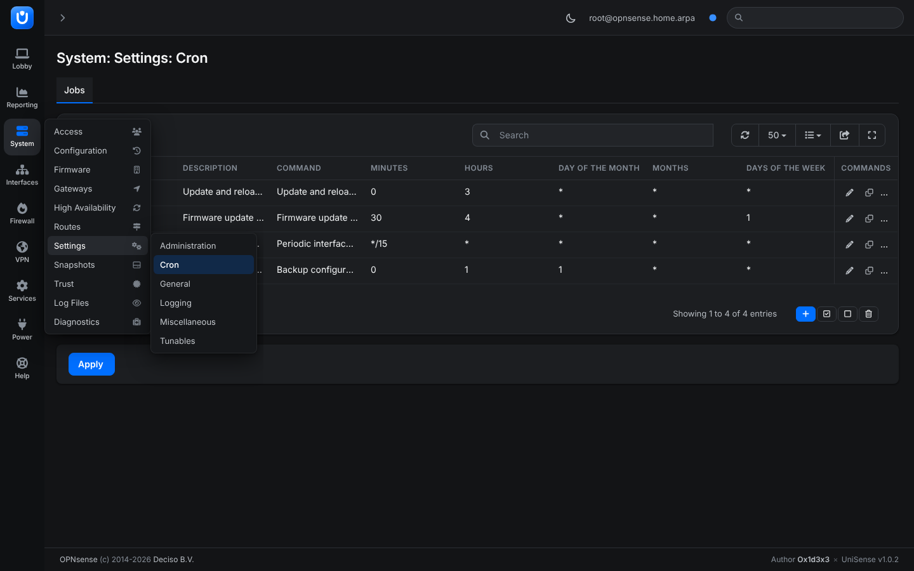

<div align="center">


# UniSense

**A clean, controller-style theme for the OPNsense web GUI.**

Dark navigation rail · card layout · quiet tables · light, dark and auto modes · six accent colours · **Network Map** · zero external requests.

[](https://github.com/ox1d3x3/unisense/actions/workflows/ci.yml)
[](https://github.com/ox1d3x3/unisense/releases/latest)
[](./LICENSE)


[Screenshots](#screenshots) · [Install](#installation) · [Network Map](#network-map) · [Use](#using-the-theme) · [FAQ](#faq) · [Build](#building-from-source) · [Releases](https://github.com/ox1d3x3/unisense/releases/latest)

<br>


</div>

### Quick install

On the firewall, as root (console **option 8 – Shell**, or SSH), paste one line:

```sh
fetch -o - https://raw.githubusercontent.com/ox1d3x3/unisense/main/install.sh | sh
```

That's it: the theme and the Network Map page are installed and the GUI switches to UniSense. Reload the browser tab (Ctrl+F5). Run the same line again any time to update.

---

## Screenshots

<table>
  <tr>
    <td width="50%"></td>
    <td width="50%"></td>
  </tr>
  <tr>
    <td align="center"><sub><b>Light mode</b></sub></td>
    <td align="center"><sub><b>Collapsed icon rail with fly-out menus</b></sub></td>
  </tr>
  <tr>
    <td width="50%"></td>
    <td width="50%"></td>
  </tr>
  <tr>
    <td align="center"><sub><b>Network Map with live traffic</b></sub></td>
    <td align="center"><sub><b>Name any device and pick its icon</b></sub></td>
  </tr>
  <tr>
    <td width="50%"></td>
    <td width="50%"></td>
  </tr>
  <tr>
    <td align="center"><sub><b>Data grids</b></sub></td>
    <td align="center"><sub><b>Edit dialogs</b></sub></td>
  </tr>
  <tr>
    <td width="50%"></td>
    <td width="50%"></td>
  </tr>
  <tr>
    <td align="center"><sub><b>Classic (PHP) pages styled too</b></sub></td>
    <td align="center"><sub><b>Sign-in page</b></sub></td>
  </tr>
  <tr>
    <td width="50%" align="center"> </td>
    <td width="50%"></td>
  </tr>
  <tr>
    <td align="center"><sub><b>Phones and tablets</b></sub></td>
    <td align="center"><sub><b>Appearance menu: mode and accent</b></sub></td>
  </tr>
</table>

---

## Features

**Look**
- Dark navigation rail in both modes, with an accent marker on the current page and a guide line for open sections
- Pages laid out as cards; dividers instead of zebra stripes; small uppercase column headings
- Rounded inputs, selects, tokens and buttons with a soft focus ring; native checkboxes and radios in the accent colour
- Status shown as soft chips (labels, alerts, gateway and service states)

**Modes and colours**
- **Light**, **Dark** or **System** (follows your OS, live) — switched from the moon/sun button in the top bar, no reload
- Six accent colours: Blue, Teal, Green, Purple, Pink, Orange
- Your choice is remembered per browser; with JavaScript off the theme still follows the OS

**Network Map** (Lobby → Network Map)
- Internet → firewall → networks → devices, at a glance; gateway health and WAN addresses on top
- Every device that is online (ARP) or has a DHCP lease (Kea, Dnsmasq or ISC), grouped by network, with vendor and hostname
- Live per-device download/upload rates, network totals, search, per-network filters, hide offline devices
- Click a device to give it a name and an icon — stored in the OPNsense configuration, so every browser and admin sees it (and it is included in backups)
- Icons are guessed automatically (phones, laptops, TVs, consoles, cameras, NAS, access points, smart-home…)

**Coverage**
- Every MVC page: forms, tabs, data grids (Tabulator), edit dialogs, dropdowns, tooltips, popovers, the status dialog
- Dashboard widgets as cards; gauges and the CPU graph follow the accent colour and recolour when you switch modes
- Classic PHP pages (bare inputs, `opnsense_standard_table_form` tables), the date picker, tokenizer, jqTree and nv.d3 charts
- Collapsed sidebar (core's icon rail with hover fly-outs) and the phone drawer
- Sign-in page

**Safe by design**
- CSS and one small, defensive script only — no core files are modified, no templates are overridden
- All colours are CSS custom properties: one stylesheet serves light and dark; a lint step fails the build if any hard-coded colour slips in
- No fonts, images or scripts are loaded from the internet

---

## Installation

### One line (recommended)

```sh
fetch -o - https://raw.githubusercontent.com/ox1d3x3/unisense/main/install.sh | sh
```

The installer downloads the latest release (or the `main` branch until the first release is published), checks it is complete, installs the theme in one step so a failed download never leaves half a theme behind, adds the Network Map page, refreshes the GUI's menu and caches, and selects the UniSense theme. Running it again updates everything.

### Menu

Download the installer and run it in a terminal to get a menu (install, install without switching theme, status, uninstall):

```sh
fetch -o /tmp/unisense.sh https://raw.githubusercontent.com/ox1d3x3/unisense/main/install.sh
sh /tmp/unisense.sh
```

### Options

| Command | What it does |
| --- | --- |
| `sh install.sh` | menu in a terminal; otherwise install/update and select the theme |
| `sh install.sh install --no-activate` | install/update but keep the current theme |
| `sh install.sh --status` | installed version, active theme, Network Map |
| `sh install.sh --uninstall` | switch back to the default theme and remove everything |
| `sh install.sh --version 1.0.0` | install a specific release |
| `sh install.sh --branch main` | install the current state of a branch |
| `sh install.sh --local DIR` | install from an extracted archive or a clone of this repository |
| `sh install.sh --url URL` | install from a `.tar.gz` at any URL (for example a CI artifact) |

Options can be passed through the one-liner too: `fetch -o - …/install.sh | sh -s -- --no-activate`.

**Private repository or fork?** `fetch` cannot sign in to GitHub. Use a token with read access; the installer then downloads with `curl` and the token:

```sh
export GITHUB_TOKEN=github_pat_xxx
curl -fsSL -H "Authorization: Bearer $GITHUB_TOKEN" https://raw.githubusercontent.com/ox1d3x3/unisense/main/install.sh | sh
```

### Manual install

1. Download `unisense.tar.gz` from the [latest release](https://github.com/ox1d3x3/unisense/releases/latest) and copy it to the firewall.
2. `tar -xzf unisense.tar.gz && sh unisense/install.sh`

### As an OPNsense plugin package

`misc/theme-unisense` follows the layout of the [opnsense/plugins](https://github.com/opnsense/plugins) repository. To build `os-theme-unisense` on a FreeBSD/OPNsense build machine, copy that directory into `plugins/misc/` and run `make package` there.

---

## Network Map

**Lobby → Network Map** shows your network the way a controller does:

- **Top:** the internet, your gateways with their status and latency, and the firewall with its WAN addresses.
- **Below:** one card per network (LAN, VLANs, …) with its subnet, how many devices are online, and live traffic. Each device shows its name, IP, vendor and live download/upload.
- **Click a device** for details (IP, MAC, vendor, hostname, network, traffic) and to set a **name** and **icon**. *Reset* returns to the detected name and the automatic icon.

Everything comes from OPNsense itself — interfaces, gateways, the ARP table, DHCP leases and the built-in traffic monitor; nothing is installed or running in the background. Live traffic samples the LAN interfaces every few seconds while the page is open (the same tool as *Reporting → Traffic*); untick **Live traffic** to turn it off. Device names live in the configuration under *UniSense*, are part of configuration backups, and can be used by any administrator.

Access is a normal privilege, **Lobby: Network Map**, so you can grant it to other users in *System → Access → Groups*. Those users also need the privileges for the data sources they should see (for example *Diagnostics: ARP Table* and *Interfaces: Overview*).

---

## Using the theme

1. The installer selects the theme for you. To switch by hand: **System → Settings → General → Theme** → **unisense** → **Save**.
2. Pick light, dark or system mode and an accent colour from the **sun/moon button** in the top bar (on phones it sits next to the menu button).

Each browser keeps its own choice. To reset it, choose **System** and **Blue**, or run `localStorage.clear()` in the browser console on the firewall's GUI.

### Uninstalling

```sh
fetch -o - https://raw.githubusercontent.com/ox1d3x3/unisense/main/install.sh | sh -s -- --uninstall
```

The GUI is switched back to the default **opnsense** theme first, then every UniSense file is removed. Device names stay in the configuration, so a reinstall picks them up again.

---

## FAQ

<details>
<summary><b>Does it survive OPNsense updates?</b></summary>

Yes. UniSense's files live in their own directories, which firmware updates do not touch. If a future OPNsense release changes its page layout, update UniSense by running the one-liner again.
</details>

<details>
<summary><b>Which OPNsense versions are supported?</b></summary>

UniSense is tested against the GUI markup of OPNsense **25.7, 26.1 and 26.7** (see [Testing](#testing)). It only adds CSS and a small script, so it does not affect how the firewall works — if something looks off after an update, switch back to the **opnsense** theme and [open an issue](https://github.com/ox1d3x3/unisense/issues).
</details>

<details>
<summary><b>Which browsers?</b></summary>

Current Chrome, Edge, Firefox and Safari (desktop and mobile). The theme uses `color-mix()` and `:has()`, available in all of them since 2023.
</details>

<details>
<summary><b>The page still looks like the old theme after updating.</b></summary>

The installer refreshes OPNsense's cache key so browsers fetch new files. If you copied files by hand, run `touch /usr/local/opnsense/www/index.php`, or force-reload the page (Ctrl+F5 / Cmd+Shift+R).
</details>

<details>
<summary><b>Some charts use orange/blue/green.</b></summary>

Dashboard gauges and the CPU graph follow your accent colour. Multi-series charts (traffic, interface statistics, firewall rules) keep OPNsense's categorical palette so their series stay distinguishable.
</details>

<details>
<summary><b>The Network Map shows a device in the wrong place or without a name.</b></summary>

Devices are grouped by the interface they were seen on (ARP) or, for DHCP-only devices, by their lease. Names come from DHCP leases; devices with a static IP and no lease show their vendor or IP — click them to give them a name. Devices that are only reachable through another router (e.g. behind a mesh in router mode) cannot be seen by the firewall and are not listed.
</details>

<details>
<summary><b>Can I change the logo or colours?</b></summary>

Logos are in `build/images/` (`default-logo.svg`, `icon-logo.svg`, `favicon.png`). Colours are design tokens in `assets/stylesheets/config/_tokens.scss` — change them and run `npm run build`.
</details>

---

## Building from source

Requirements: Node.js 18 or newer.

```sh
npm ci
npm run build      # compile assets/stylesheets -> build/css
npm run lint       # stylesheet checks (parse, colour tokens, url()) + ESLint on the browser scripts
npm test           # build check + lint + installer tests (tests/test-install.sh)
sh scripts/check-plugin.sh   # PHP syntax, XML, model masks, Volt helpers
sh scripts/package.sh   # dist/unisense.tar.gz + install.sh + SHA256SUMS
```

```
misc/theme-unisense/                       plugin directory (opnsense/plugins layout)
└─ src/opnsense/www/themes/unisense/
   ├─ assets/stylesheets/                  SCSS sources
   │  ├─ config/_tokens.scss               light / dark / common design tokens
   │  ├─ config/_bootstrap-vars.scss       Bootstrap 3 variables mapped to tokens
   │  ├─ config/_compat.scss               darken()/rgba()… shims that work on CSS variables
   │  ├─ core/_layout.scss                 upstream OPNsense layout rules (tokenised)
   │  ├─ unisense/                         the UniSense design layer
   │  └─ main.scss, dashboard.scss, …      one entry per stylesheet OPNsense loads
   └─ build/                               what OPNsense serves (css, js/theme.js, images)
```

### Testing

`tests/harness` renders **real OPNsense core templates** (the layout, menu, forms, grids and dialogs from a checkout of [opnsense/core](https://github.com/opnsense/core)) with the theme applied, serves them with canned API responses, and drives them in Chromium:

```sh
pip install playwright jinja2 pillow && playwright install chromium
git clone --depth 1 -b stable/26.7 https://github.com/opnsense/core /tmp/core
cd tests/harness
python3 render.py   --core /tmp/core      # build the pages
python3 shoot.py    --core /tmp/core      # screenshots, light/dark, desktop/phone; fails on JS errors or missing files
python3 interact.py --core /tmp/core      # appearance menu, accents, charts, selects, dialogs, drawer, tablet widths, Network Map
```

CI runs all of this against OPNsense 25.7, 26.1 and 26.7 on every push and uploads the screenshots as an artifact.

---

## Contributing

Issues and pull requests are welcome. For visual bugs, please include the OPNsense version, the page (menu path), light or dark mode, your browser, and a screenshot.

## Changelog

Release notes are on the [Releases](https://github.com/ox1d3x3/unisense/releases) page.

---

<div align="center">

Made by [ox1d3x3](https://github.com/ox1d3x3) · Licensed under [BSD 2-Clause](./LICENSE) · Sibling of [UniWRT](https://github.com/ox1d3x3/uniwrt-luci) for OpenWrt

UniSense is an independent project and is not affiliated with or endorsed by Deciso B.V., the OPNsense project or Ubiquiti Inc.

If UniSense is useful to you, a ⭐ helps others find it.

</div>
