<div align="center">


# UniSense

**A clean, controller-style theme for the OPNsense web GUI.**

Dark navigation rail · card layout · live dashboard meters · light, dark and auto modes · six accent colours · **Network Map** · **Traffic Map** · no external requests from the GUI.

[](https://github.com/ox1d3x3/unisense/releases/latest)
[](https://github.com/ox1d3x3/unisense/releases)
[](https://github.com/ox1d3x3/unisense/stargazers)
[](https://github.com/ox1d3x3/unisense/actions/workflows/ci.yml)
[](./LICENSE)


[Screenshots](#screenshots) · [Install](#installation) · [Network Map](#network-map) · [Traffic Map](#traffic-map) · [Use](#using-the-theme) · [FAQ](#faq) · [Build](#building-from-source) · [Releases](https://github.com/ox1d3x3/unisense/releases/latest)

<br>


</div>

### Quick install

On the firewall, as root (console **option 8 – Shell**, or SSH), paste one line:

```sh
fetch -o - https://raw.githubusercontent.com/ox1d3x3/unisense/main/install.sh | sh
```

That's it: the theme, the Network Map and the Traffic Map are installed and the GUI switches to UniSense. Reload the browser tab (Ctrl+F5). Run the same line again any time to update.

UniSense survives OPNsense firmware updates: it checks itself after every update and at boot, and puts back anything that went missing (see the [FAQ](#faq)).

---

## Screenshots

<table>
  <tr>
    <td width="50%"></td>
    <td width="50%"></td>
  </tr>
  <tr>
    <td align="center"><sub><b>Light mode</b></sub></td>
    <td align="center"><sub><b>Collapsed icon rail with fly-out menus</b></sub></td>
  </tr>
  <tr>
    <td width="50%">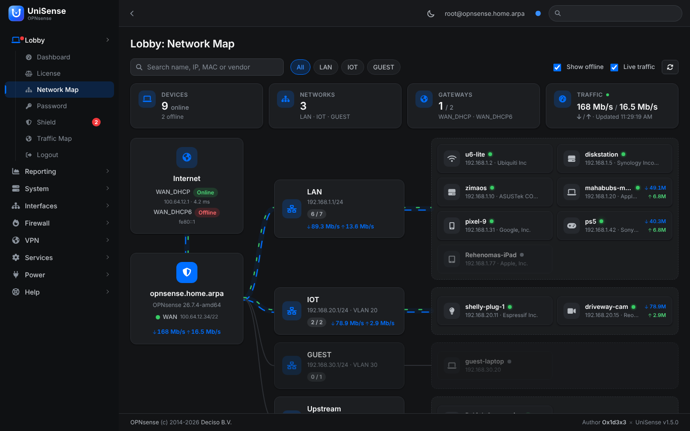</td>
    <td width="50%">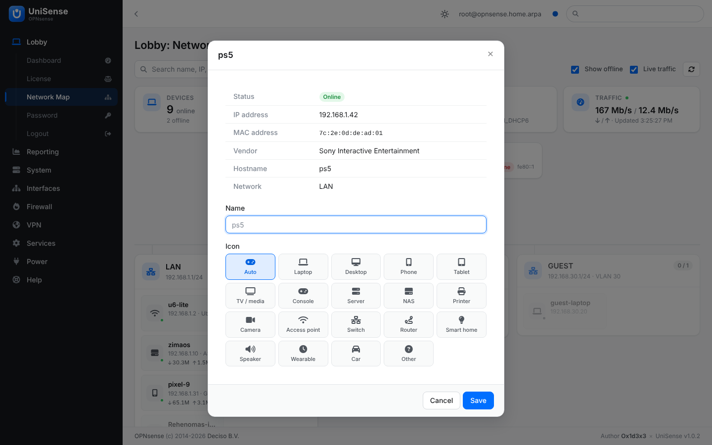</td>
  </tr>
  <tr>
    <td align="center"><sub><b>Network Map with live traffic</b></sub></td>
    <td align="center"><sub><b>Name any device and pick its icon</b></sub></td>
  </tr>
  <tr>
    <td width="50%">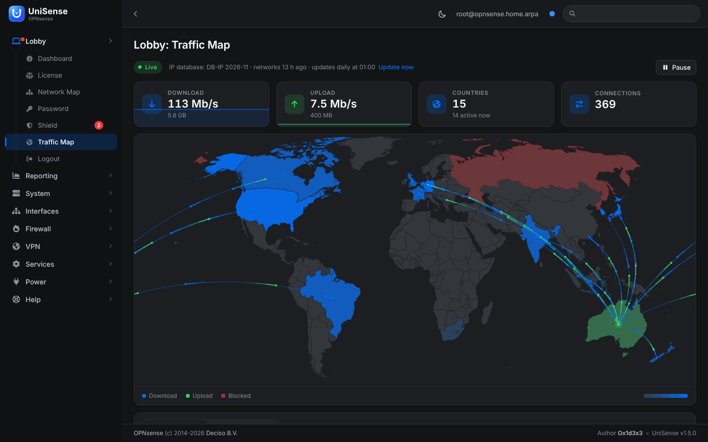</td>
    <td width="50%">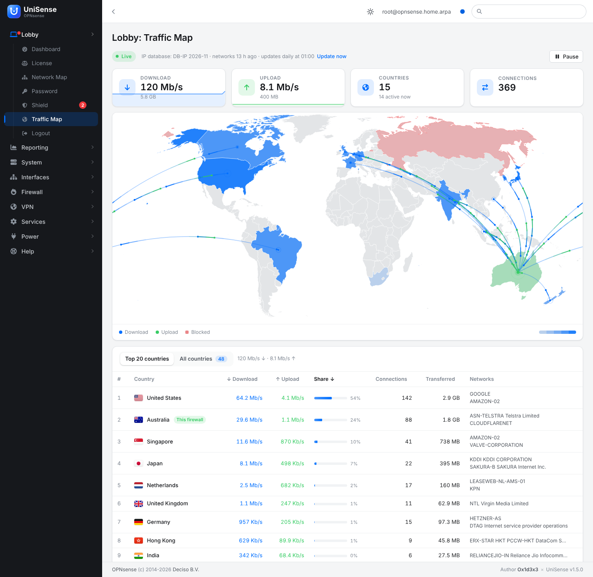</td>
  </tr>
  <tr>
    <td align="center"><sub><b>Traffic Map: live traffic by country</b></sub></td>
    <td align="center"><sub><b>Top 20 countries and their networks</b></sub></td>
  </tr>
  <tr>
    <td width="50%">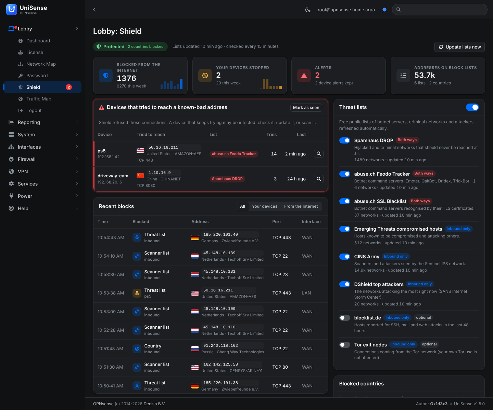</td>
    <td width="50%">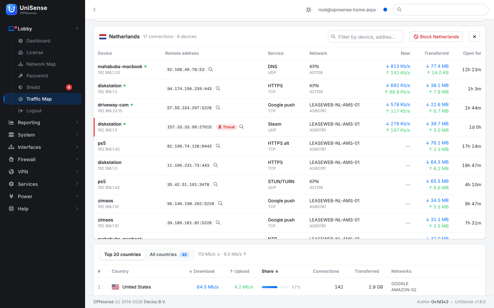</td>
  </tr>
  <tr>
    <td align="center"><sub><b>Shield: threat lists, blocks and alerts</b></sub></td>
    <td align="center"><sub><b>Block a country right from its connections</b></sub></td>
  </tr>
  <tr>
    <td colspan="2">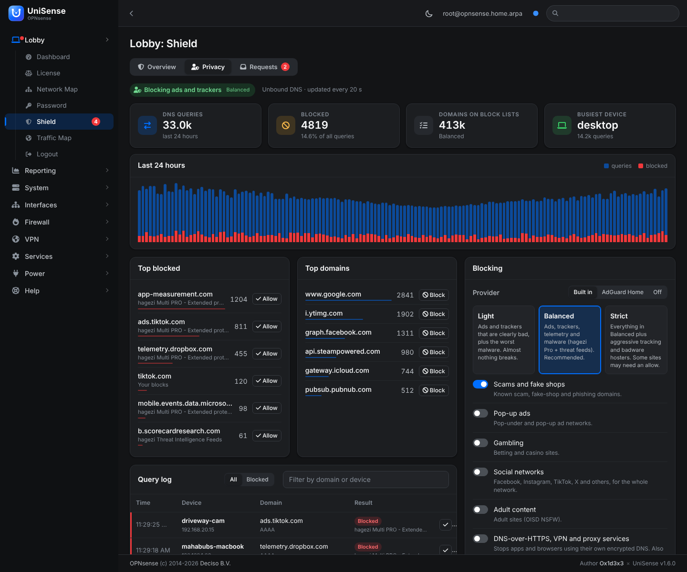</td>
  </tr>
  <tr>
    <td colspan="2" align="center"><sub><b>Privacy: ad and tracker blocking, gaming-safe, with a query log</b></sub></td>
  </tr>
  <tr>
    <td>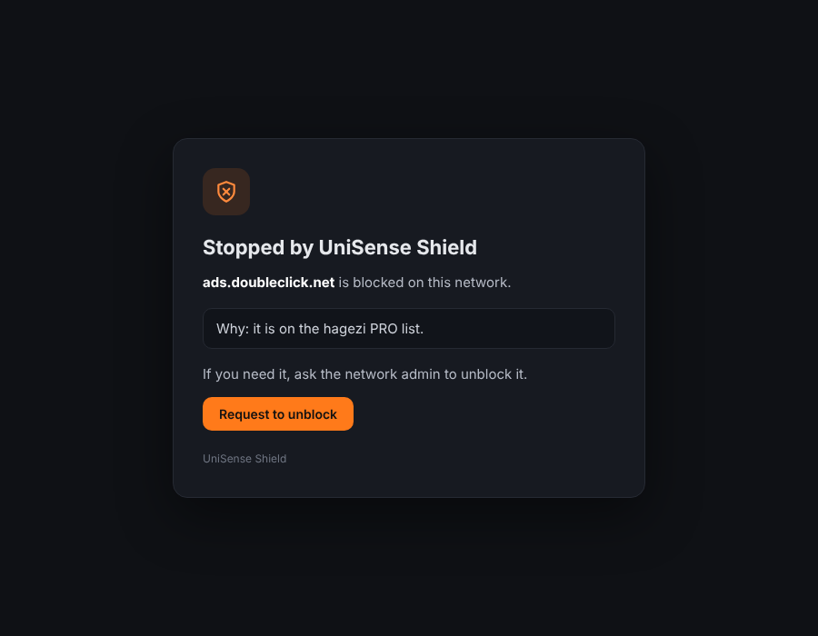</td>
    <td>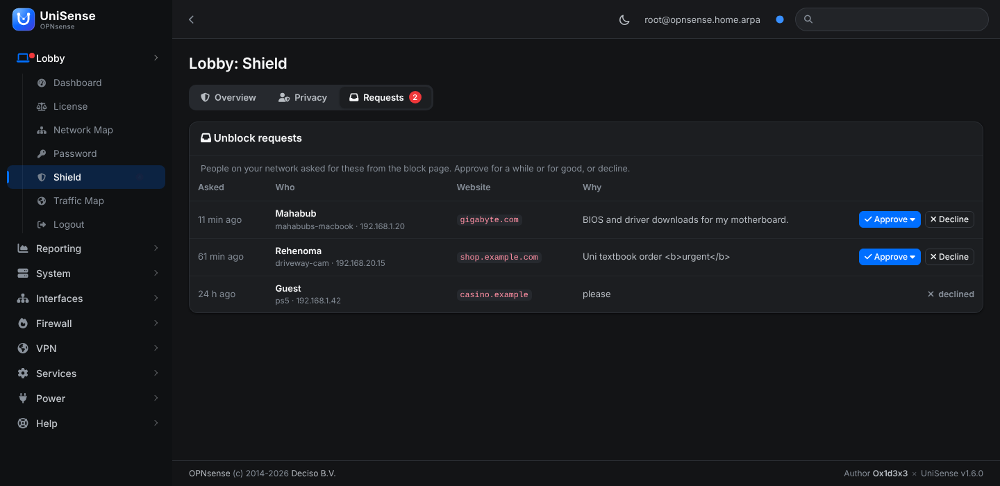</td>
  </tr>
  <tr>
    <td align="center"><sub><b>The block page, with Request to unblock</b></sub></td>
    <td align="center"><sub><b>Requests: approve for a while or for good</b></sub></td>
  </tr>
  <tr>
    <td width="50%"></td>
    <td width="50%">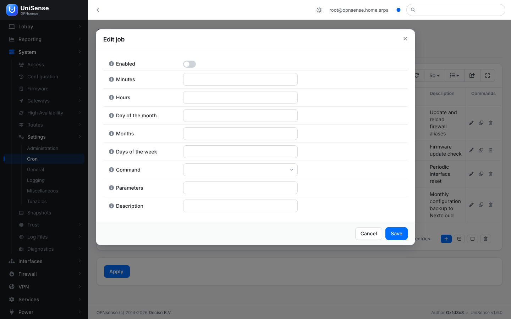</td>
  </tr>
  <tr>
    <td align="center"><sub><b>Data grids</b></sub></td>
    <td align="center"><sub><b>Edit dialogs</b></sub></td>
  </tr>
  <tr>
    <td width="50%">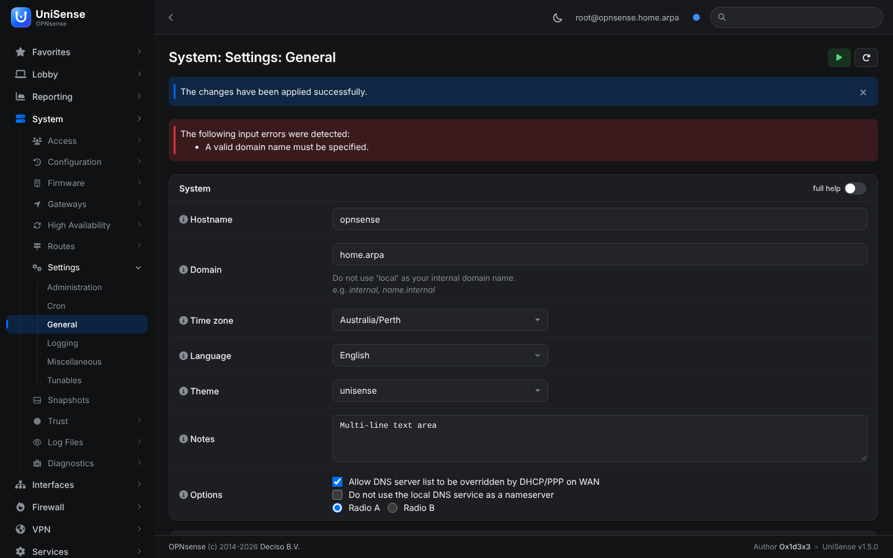</td>
    <td width="50%">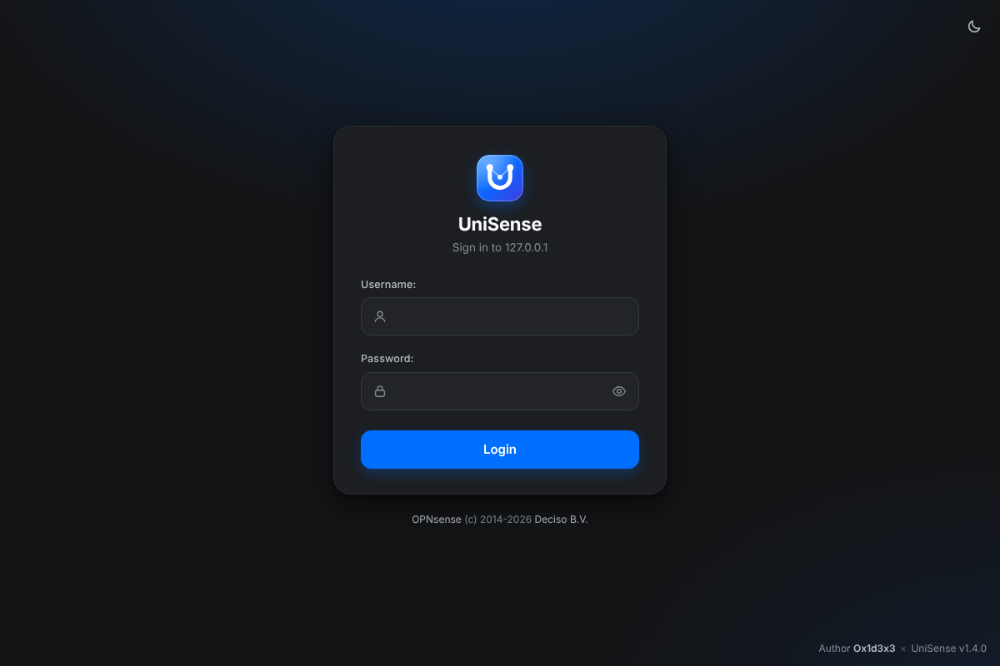</td>
  </tr>
  <tr>
    <td align="center"><sub><b>Classic (PHP) pages styled too</b></sub></td>
    <td align="center"><sub><b>Sign-in page</b></sub></td>
  </tr>
  <tr>
    <td width="50%" align="center"> 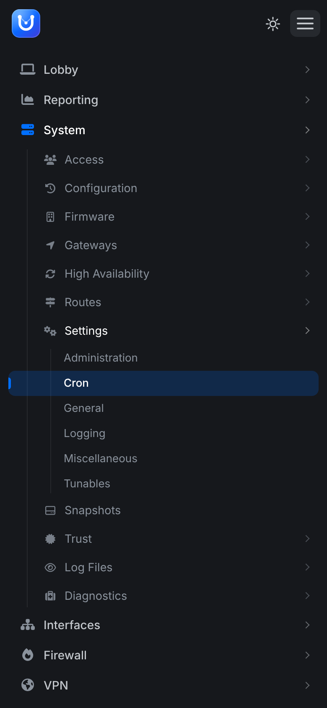</td>
    <td width="50%"></td>
  </tr>
  <tr>
    <td align="center"><sub><b>Phones and tablets</b></sub></td>
    <td align="center"><sub><b>Appearance menu: mode and accent</b></sub></td>
  </tr>
</table>

---

## Features

**Look**
- Dark navigation rail in both modes, with an accent marker on the current page and a guide line for open sections
- Pages laid out as cards; dividers instead of zebra stripes; sentence-case column headings that wrap instead of being cut off
- Rounded inputs, selects, tokens and buttons with a soft focus ring
- Real on/off switches (36 × 20) for every setting in MVC forms and edit dialogs, the *advanced mode* / *full help* toggles and the grid *Enabled* columns; checkboxes and radios elsewhere in the accent colour
- Status shown as soft chips (labels, alerts, gateway and service states)

**Modes and colours**
- **Light**, **Dark** or **System** (follows your OS, live) — switched from the moon/sun button in the top bar, no reload
- Six accent colours: Blue, Teal, Green, Purple, Pink, Orange
- Your choice is remembered per browser; with JavaScript off the theme still follows the OS
- **Keep all sections open**: an option in the same menu that shows every menu section at once (clicking a header still folds just that one)

**Network Map** (Lobby → Network Map)
- Laid out in columns like a network diagram: Internet and the firewall on the left, one card per network in the middle, each network's devices to its right; gateway health and WAN addresses on the Internet and firewall cards
- Every device that is online (ARP) or has a DHCP lease (Kea, Dnsmasq or ISC), grouped by network, with vendor and hostname
- Live per-device download/upload rates, network totals, search, per-network filters, hide offline devices
- Click a device to give it a name and an icon — stored in the OPNsense configuration, so every browser and admin sees it (and it is included in backups)
- Icons are guessed automatically (phones, laptops, TVs, consoles, cameras, NAS, access points, smart-home…)
- Live data flow: a busy connector becomes a soft cable with two lanes — download (blue streaks) towards the devices, upload (green dashes) back — at a speed that follows the traffic; idle links stay a plain line
- A live dot right after each device's name, which ripples while the device is busy

**Traffic Map** (Lobby → Traffic Map)
- World map of where your traffic goes right now: countries shaded by traffic, arcs from your firewall with streaks of light (download towards you, upload away); speeds glide and arcs fade in and out between refreshes
- Live download/upload sparklines; the table updates in place and rows slide to their new rank
- Top 20 countries with live download/upload, share, connections, data transferred and the networks (e.g. GOOGLE, AMAZON-02) behind them
- **All countries**: every country your network has talked to, recorded every minute even while the page is closed — downloaded, uploaded, connections, when it was last seen; sortable and searchable
- **Connections**: open a country (or the *Connections* card for everything) to see each connection — which device, the remote address and port, the service (HTTPS, DNS, NTP, Steam, …), the network behind it, live rate, data transferred and how long it has been open; filterable
- Hover a country for details, click a row for its top networks, pause/resume
- IP-to-country data is downloaded to the firewall and refreshed daily at 01:00 — lookups never leave your network

**Shield** (Lobby → Shield)
- **Block countries** from the Traffic Map (one click on a country's connections) or the Shield page: connections from them are dropped and your devices get an instant refusal, so nothing hangs; open connections end straight away
- **Threat lists that update themselves** — free public feeds of botnet command servers, hijacked/criminal networks and active attackers (Spamhaus DROP, abuse.ch Feodo Tracker, Emerging Threats, CINS Army, DShield; blocklist.de and Tor exits optional), checked every 15 minutes
- **Alerts** when a device on your network tries to reach a known-bad address — usually the first sign of an infected device — with a red count on the menu
- Live counters, the latest blocks, an **address check** (country, network, which lists, and VirusTotal / AbuseIPDB scores with a free API key) and a short **security checkup** of your settings
- **Gaming-safe**: just firewall table lookups (no packet inspection, no added latency), and scanner lists only ever block inbound

- **Alerts you can clear**: *Mark as seen* folds them into "Earlier alerts"; *Dismiss* hides one until that device tries again

**Block page and unblock requests** (Lobby → Shield)
- A blocked website shows **"Stopped by UniSense Shield"**, the reason, and a **Request to unblock** button, instead of a broken page
- People ask with their name and why (100 words max), on the page or at `http://unblock.<your domain>`; you **Approve** for 1 hour, 24 hours, 1 month or always, or **Decline**, in the *Requests* tab, with a count on the menu
- HTTPS sites show the page on devices that trust a CA you choose from *System → Trust → Authorities*

**Privacy** (Lobby → Shield → Privacy)
- **Ad and tracker blocking for every device**, like Pi-hole or AdGuard, built into the firewall: one switch, three levels (Light, Balanced, Strict) on the hagezi lists that ship with OPNsense, plus scams, pop-ups, gambling, social networks, adult content and DNS-over-HTTPS / VPN services
- **Gaming-safe** by default: logins, stores, matchmaking, anti-cheat and voice for PlayStation, Xbox, Steam, Battle.net, Ubisoft, Activision, EA, Epic, Riot and Discord are never blocked
- A dashboard: queries and share blocked, the last 24 hours, top blocked domains, top domains, busiest devices, and a searchable query log with **Allow / Block** on every line
- **Already run AdGuard Home?** Connect it instead: the same dashboard, allow / block and its filtering switch
- **Stops devices going around it**: sends hard-coded DNS (8.8.8.8) to the firewall and refuses DNS-over-TLS to other servers

**Coverage**
- Every MVC page: forms, tabs, data grids (Tabulator), edit dialogs, dropdowns, tooltips, popovers, the status dialog
- Dashboard widgets as cards. The CPU widget gets a taller live graph with the load in large type, user / system / interrupt, a one-minute average and the CPU temperature. Memory, Disk, Firewall States, Swap and Mbuf become live meters: the value in large type, a live graph of the last minutes, a capacity bar and a legend. Ring charts with dot legends, thin smooth traffic lines, pill-shaped thermal bars, a modern series palette — all follow the accent colour and recolour when you switch modes
- Classic PHP pages (bare inputs, `opnsense_standard_table_form` tables), the date picker, tokenizer, jqTree and nv.d3 charts
- Collapsed sidebar (core's icon rail with hover fly-outs) and the phone drawer
- Sign-in page: app-icon card, show-password button, Caps Lock hint, busy state while signing in

**Smooth on big screens**
- Motion only on transform and opacity (GPU-composited); menu highlights are instant, so nothing trails the pointer
- Opaque top bar (no backdrop blur), no fixed backgrounds, compressed CSS
- Light/dark switches in a single frame instead of hundreds of colour fades; dashboard widgets no longer slide around while they load
- Network Map tiles keep their size while traffic comes and goes, and periodic refreshes only touch what changed
- Honours *reduce motion* in the OS; measured with `tests/harness/perf.py` against the stock theme

**Safe by design**
- CSS and one small, defensive script only — no core files are modified, no templates are overridden
- All colours are CSS custom properties: one stylesheet serves light and dark; a lint step fails the build if any hard-coded colour slips in
- No fonts, images or scripts are loaded from the internet

---

## Installation

### One line (recommended)

```sh
fetch -o - https://raw.githubusercontent.com/ox1d3x3/unisense/main/install.sh | sh
```

The installer downloads the latest release (or the `main` branch until the first release is published), checks it is complete, installs the theme in one step so a failed download never leaves half a theme behind, adds the Network Map page, refreshes the GUI's menu and caches, and selects the UniSense theme. Running it again updates everything.

### Menu

Download the installer and run it in a terminal to get a menu (install, install without switching theme, status, uninstall):

```sh
fetch -o /tmp/unisense.sh https://raw.githubusercontent.com/ox1d3x3/unisense/main/install.sh
sh /tmp/unisense.sh
```

### Options

| Command | What it does |
| --- | --- |
| `sh install.sh` | menu in a terminal; otherwise install/update and select the theme |
| `sh install.sh install --no-activate` | install/update but keep the current theme |
| `sh install.sh --status` | installed version, active theme, Network Map |
| `sh install.sh --uninstall` | switch back to the default theme and remove everything |
| `sh install.sh --version 1.0.0` | install a specific release |
| `sh install.sh --branch main` | install the current state of a branch |
| `sh install.sh --local DIR` | install from an extracted archive or a clone of this repository |
| `sh install.sh --url URL` | install from a `.tar.gz` at any URL (for example a CI artifact) |

Options can be passed through the one-liner too: `fetch -o - …/install.sh | sh -s -- --no-activate`.

**Installing from a private fork?** `fetch` cannot sign in to GitHub. Use a token with read access; the installer then downloads with `curl` and the token:

```sh
export GITHUB_TOKEN=github_pat_xxx
curl -fsSL -H "Authorization: Bearer $GITHUB_TOKEN" https://raw.githubusercontent.com/ox1d3x3/unisense/main/install.sh | sh
```

### Manual install

1. Download `unisense.tar.gz` from the [latest release](https://github.com/ox1d3x3/unisense/releases/latest) and copy it to the firewall.
2. `tar -xzf unisense.tar.gz && sh unisense/install.sh`

### As an OPNsense plugin package

`misc/theme-unisense` follows the layout of the [opnsense/plugins](https://github.com/opnsense/plugins) repository. To build `os-theme-unisense` on a FreeBSD/OPNsense build machine, copy that directory into `plugins/misc/` and run `make package` there.

---

## Network Map

**Lobby → Network Map** shows your network the way a controller does:

- **Left:** the internet, your gateways with their status and latency, and the firewall with its WAN addresses and total traffic.
- **Middle:** one card per network (LAN, VLANs, …), connected to the firewall, with its subnet, how many devices are online, and live traffic.
- **Right:** each network's devices, side by side; each shows its name with a live dot, IP, vendor and live download/upload.
- On narrower screens the networks stack under the firewall, each with its devices underneath.
- **Click a device** for details (IP, MAC, vendor, hostname, network, traffic) and to set a **name** and **icon**. *Reset* returns to the detected name and the automatic icon.

Everything comes from OPNsense itself — interfaces, gateways, the ARP table, DHCP leases and the built-in traffic monitor; nothing is installed or running in the background. Live traffic samples the LAN interfaces every few seconds while the page is open (the same tool as *Reporting → Traffic*); untick **Live traffic** to turn it off. Device names live in the configuration under *UniSense*, are part of configuration backups, and can be used by any administrator.

Access is a normal privilege, **Lobby: Network Map**, so you can grant it to other users in *System → Access → Groups*. Those users also need the privileges for the data sources they should see (for example *Diagnostics: ARP Table* and *Interfaces: Overview*).

---

## Traffic Map

**Lobby → Traffic Map** shows which countries your network is talking to, live.

- **Map:** every country your firewall has connections with is shaded by how much traffic it carries; arcs run from your firewall's country to the busiest ones, with streaks of light flowing in (download) and out (upload) at a speed that follows the traffic. Hover a country for its rates, connections and networks.
- **Top 20 countries:** download and upload now, share of all traffic, open connections, data transferred over those connections, and the networks (autonomous systems) behind them. Click a row for its top five networks.
- **Connections:** click *Show the connections* under a country (or a country in *All countries*, or the *Connections* card for every country). Each line shows the device on your network (its Network Map name or hostname), the remote address and port, the service, the network (AS) it belongs to, the live download/upload, the data transferred so far and how long the connection has been open. The busiest 300 are listed; type to filter by device, address, service or network.
- **All countries:** every country your network has talked to since the history started, with data downloaded and uploaded, connections, and when it was last seen ("now" with the live rate if it is active). Sort by any column, search by name; *Clear history* starts afresh. Countries not seen for 90 days are dropped. Clicking the *Countries* card opens this list.

**Where the data comes from.** The page reads the firewall's state table (`pfctl`), the same connections *Firewall → Diagnostics → States* lists, and merges the LAN and NAT copies of each connection. Rates are the change in byte counters between two reads (every 3 seconds while the page is open). For the *All countries* history a second cron job, **UniSense: record Traffic Map history**, reads the state table once a minute, also while the page is closed; it adds only what moved since the previous read, and keeps the totals in `/var/db/unisense/trafficmap-history.json` (written at most once a minute). Connections that start and end between two reads are not counted.

**IP databases.** Two free databases are stored on the firewall in `/var/db/unisense` (about 40 MB) and looked up locally — no address is ever sent to a web service:

| Database | What it gives | Licence | Refreshed |
|---|---|---|---|
| [DB-IP IP to Country Lite](https://db-ip.com/db/download/ip-to-country-lite) | the country an address is **located** in | CC BY 4.0 | monthly release |
| [iptoasn.com](https://iptoasn.com) `ip2asn-combined` | the **network** (AS number and organisation), and its registration country as a fallback | public domain | daily |

The installer downloads them once and adds a cron job, **UniSense: update IP-to-country databases**, that runs daily at **01:00** (change the time in *System → Settings → Cron*). *Update now* on the page refreshes them on demand.

**Your firewall's country** comes from its own public address. Behind CGNAT or another router (no public address on the firewall), the country of the time zone set in *System → Settings → General* is used instead.

Access is a separate privilege, **Lobby: Traffic Map**.

---

## Shield

**Lobby → Shield** blocks countries and known-bad addresses for every device on your network, and tells you when one of them tries to reach something it shouldn't.

**Blocking a country.** On the Traffic Map, open a country's connections and click **Block** (it warns first if games or voice chat are using that country right now), or add it on the Shield page. Connections *from* that country are dropped; connections *to* it from your devices are refused at once (an immediate error instead of a time-out), and the ones already open are ended. Blocked countries are shaded red on the map. Countries come from the same DB-IP database as the Traffic Map, so it must be downloaded first.

**Threat lists.** Switch them on with the switch on the *Threat lists* card; each list can be turned on or off:

| List | What it contains | Blocks | Default |
|---|---|---|---|
| [Spamhaus DROP](https://www.spamhaus.org/drop/) | hijacked and criminal networks | both ways | on |
| [abuse.ch Feodo Tracker](https://feodotracker.abuse.ch/blocklist/) | active botnet command servers (Emotet, QakBot, …) — often only a few at a time | both ways | on |
| [Emerging Threats](https://rules.emergingthreats.net/) compromised hosts | hosts attacking others | inbound | on |
| [CINS Army](https://cinsscore.com/) | scanners and attackers | inbound | on |
| [DShield](https://isc.sans.edu/) top attackers | the networks attacking the most | inbound | on |
| [blocklist.de](https://www.blocklist.de/) | SSH/mail/web attackers, last 48 h | inbound | off |
| [Tor exit nodes](https://www.torproject.org/) | connections from the Tor network | inbound | off |

"Both ways" lists are high-confidence: your devices cannot reach them either, and every attempt becomes an **alert**. Scanner lists only block traffic coming in, so even if one wrongly lists a game server, your outgoing connections are never affected. A cron job, **UniSense: refresh the Shield threat lists**, runs every 15 minutes. Feodo Tracker is refreshed every 15 minutes, the others hourly (Spamhaus every 6 hours, as it asks). Most of the "both ways" protection comes from Spamhaus DROP (about 1,500 hijacked and criminal networks); Feodo Tracker lists active botnet servers only while a campaign runs, so it is often nearly empty. A download that fails or looks wrong never replaces the last good copy. *Update lists now* fetches everything on demand.

**What it changes in your firewall.** Shield adds three *External* aliases (`unisense_geoblock`, `unisense_threats`, `unisense_scanners`) and five floating block rules named **UniSense Shield: …**, visible under *Firewall → Rules* (*Automation* on 25.7). The rules match traffic entering any interface: from the Internet with a listed source (dropped), or from your devices to a listed destination (refused). Every rule logs, which is how the counters and alerts are made. Private, CGNAT, link-local and loopback ranges, the firewall's own addresses and every **allowed address** are always exempt (a list entry that overlaps them is dropped, and they are added to every table as exceptions). pf empties tables at boot; UniSense fills them again automatically.

**Allowing an address.** Lists are sometimes wrong — a hosting range gets listed and a legitimate site with it. Click the 🔓 button on an alert, a block or an address check and choose how long to let it through: **1 hour, 6 hours, 24 hours, 1 month, until the firewall restarts, or always**. It takes effect at once; timed ones end by themselves and are listed with their time left under *Allowed addresses*, where × blocks it again. "Always" adds it to the permanent list below them.

**Address check.** Type any IP (or click 🔍 next to a block or connection): its country and network, the lists it is on, and whether Shield blocks it. Add a free [VirusTotal](https://www.virustotal.com/gui/join-us) or [AbuseIPDB](https://www.abuseipdb.com/register) API key under *Reputation lookups* to see their scores too (the lookup is made by the firewall, only when you click; keys stay in the configuration).

**Security checkup.** A read-only look at a few settings that matter on a home firewall: HTTPS for the GUI, SSH root password login, private/bogon blocking on WAN, DNSSEC, a DNS blocklist for malware domains, the threat lists, and what is open to the whole Internet. Each item links to the page where it is set.

Access is a separate privilege, **Lobby: Shield**. Uninstalling UniSense removes the Shield rules and aliases.

## Privacy

**Lobby → Shield → Privacy** blocks ads, trackers and malware domains for every device on the network. Pick where the blocking happens:

- **Built in (recommended).** The firewall's own DNS (Unbound) does it, so there is nothing to install. UniSense adds one policy, **UniSense Privacy**, to *Services → Unbound DNS → Blocklist* (any policies of your own keep working) and switches on Unbound's query statistics for the dashboard. Lists come with OPNsense:

  | Level | Lists | Good for |
  |---|---|---|
  | Light | hagezi LIGHT + threat feeds (mini) | almost nothing breaks |
  | **Balanced** | hagezi PRO + threat feeds | recommended |
  | Strict | hagezi PRO++ + threat feeds + badware hosters | the odd site may need an Allow |

  Extras: scams and fake shops, pop-up ads, gambling, social networks (26.1+), adult content, and DNS-over-HTTPS / VPN / proxy services.
- **AdGuard Home.** If you already run it on another machine, enter its address and login. UniSense shows its numbers and query log, and Allow / Block go into its custom rules. Lists stay managed in AdGuard Home.

**Gaming-safe** (on by default) keeps logins, stores, matchmaking, anti-cheat and voice working for PlayStation, Xbox, Steam, Battle.net, Ubisoft, Activision, EA, Epic, Riot and Discord, whatever the lists say. With AdGuard Home, one button adds the same allow rules there.

**Allow and block.** Every line of the top lists and the query log has an Allow or Block button; *Your rules* lists them, and you can type a domain. A blocked domain includes all its subdomains.

**Stop devices going around it.** Some devices use their own DNS. Choose the interfaces (LAN, IoT, Guest …), then:
- *Send all plain DNS to this firewall* (built in, OPNsense 26.1+): a port forward answers hard-coded 8.8.8.8 / 1.1.1.1 queries from the firewall, so blocking still applies;
- *Refuse DNS-over-TLS to other servers*: phones using "Private DNS" fall back to yours;
- DNS-over-HTTPS hides in normal web traffic: switch on the *DNS-over-HTTPS, VPN and proxy services* extra (it also blocks public VPN services, so leave it off if you use one).

**Block page.** Under *Stop devices going around it*, switch on *Show a page instead of a broken site*. Blocked names then point at a private address only the firewall answers on (198.18.0.80 by default: change it if it is on one of your networks), where a small UniSense server shows "Stopped by UniSense Shield", the reason and a **Request to unblock** form. On 26.1 and later, web visits to Shield's known-bad addresses show it too.

- **HTTPS**: a page for `https://` sites needs a certificate for each site. Choose a CA from *System → Trust → Authorities* (for example the one your firewall's own GUI certificate comes from) and devices that trust it see the page; other devices see the browser's certificate warning instead, and can still ask at `http://unblock.<your domain>`. Without a CA, HTTPS visits fail at once, as before.
- **Requests** arrive in *Lobby → Shield → Requests*: who, from which device, which website and why. **Approve** for 1 hour, 24 hours, 1 month or always (a website goes on the Privacy allow list for that time; an address gets a Shield allow), or **Decline**. Each device can send 5 requests an hour.
- Only page visits get the page: ads, scripts and images that a page loads are answered empty, so a page full of blocked ads costs nothing. Apps and games never show it: they just can't connect, as before.

Privacy now lives in Shield; the separate **Lobby: Privacy** privilege still covers just Privacy. Switching Privacy off disables the policy and removes the rules; uninstalling UniSense removes the policy, the rule and the port forwards.

---

## Using the theme

1. The installer selects the theme for you. To switch by hand: **System → Settings → General → Theme** → **unisense** → **Save**.
2. Pick light, dark or system mode and an accent colour from the **sun/moon button** in the top bar (on phones it sits next to the menu button).

Each browser keeps its own choice. To reset it, choose **System** and **Blue**, or run `localStorage.clear()` in the browser console on the firewall's GUI.

### Uninstalling

```sh
fetch -o - https://raw.githubusercontent.com/ox1d3x3/unisense/main/install.sh | sh -s -- --uninstall
```

The GUI is switched back to the default **opnsense** theme first, then the Shield rules and aliases, every UniSense file, the IP databases and the scheduled jobs are removed. Device names stay in the configuration, so a reinstall picks them up again.

---

## FAQ

<details>
<summary><b>Does it survive OPNsense updates?</b></summary>

Yes. UniSense's files live in their own directories, which firmware updates do not touch. If a future OPNsense release changes its page layout, update UniSense by running the one-liner again.
</details>

<details>
<summary><b>Which OPNsense versions are supported?</b></summary>

UniSense is tested against the GUI markup of OPNsense **25.7, 26.1 and 26.7** (see [Testing](#testing)). It only adds CSS and a small script, so it does not affect how the firewall works — if something looks off after an update, switch back to the **opnsense** theme and [open an issue](https://github.com/ox1d3x3/unisense/issues).
</details>

<details>
<summary><b>Which browsers?</b></summary>

Current Chrome, Edge, Firefox and Safari (desktop and mobile). The theme uses `color-mix()` and `:has()`, available in all of them since 2023.
</details>

<details>
<summary><b>The page still looks like the old theme after updating.</b></summary>

The installer refreshes OPNsense's cache key so browsers fetch new files. If you copied files by hand, run `touch /usr/local/opnsense/www/index.php`, or force-reload the page (Ctrl+F5 / Cmd+Shift+R).
</details>

<details>
<summary><b>Some charts use orange/blue/green.</b></summary>

Dashboard meters and the CPU graph follow your accent colour. Multi-series charts (traffic, interface statistics, firewall rules) keep OPNsense's categorical palette so their series stay distinguishable.
</details>

<details>
<summary><b>Will a firmware update break or remove the theme?</b></summary>

No. OPNsense updates replace only the files of their own packages; UniSense's files are left alone. On top of that the installer adds a self-check (`/usr/local/opnsense/scripts/unisense/heal.sh`) that OPNsense runs after every firmware update and at every boot. It verifies every installed file against the installer's list, restores anything missing or empty from a copy of the same release kept in `/var/db/unisense/keep`, and clears the menu cache so the Lobby pages appear under the new core. It never changes your selected theme or cron jobs, and does nothing when all is in place (`sh install.sh --status` shows "Self-repair"). Each release is tested against OPNsense 25.7, 26.1 and 26.7 before it is published.
</details>

<details>
<summary><b>The Network Map shows a device in the wrong place or without a name.</b></summary>

Devices are grouped by the interface they were seen on (ARP) or, for DHCP-only devices, by their lease. Names come from DHCP leases; devices with a static IP and no lease show their vendor or IP — click them to give them a name. Devices that are only reachable through another router (e.g. behind a mesh in router mode) cannot be seen by the firewall and are not listed.
</details>

<details>
<summary><b>Why does the Traffic Map show my own country so high?</b></summary>

Big services (Netflix, YouTube, Cloudflare, game and update servers) answer from caches close to you, often inside your ISP. The Traffic Map shows where the server you are talking to **is**, so that traffic counts for your own country — which is correct, even if the company is American.
</details>

<details>
<summary><b>The Traffic Map says the database is missing.</b></summary>

The first download runs in the background after installing and takes about a minute. If the firewall could not reach `iptoasn.com` or `download.db-ip.com` then, click **Download now**, or run `configctl unisense geoip update` in a shell. Errors are shown under *IP database* on the page and in the system log.
</details>

<details>
<summary><b>Will Shield slow down my games?</b></summary>

No. Shield only adds lookups in pf's address tables (a radix tree: microseconds, the same mechanism as any alias). Nothing is inspected, proxied or queued. The scanner lists only block traffic coming in, so they can never touch an outgoing game connection. The one thing to think about is **blocking a country**: game servers and matchmaking often run in nearby countries (for Australia, often Singapore or Japan). The Traffic Map warns you when games or voice chat are using a country right now.
</details>

<details>
<summary><b>Something stopped working after I turned Shield on.</b></summary>

Open **Lobby → Shield → Recent blocks**, find the address and click 🔍 to see which list or country blocked it. Then click 🔓 to allow it (for an hour, a day, a month or always), unblock the country, or switch that list off. To switch everything off at once, turn the *Threat lists* switch off and remove the blocked countries; the rules stay but match nothing.
</details>

<details>
<summary><b>A site or app stopped working after I turned on Privacy.</b></summary>

Open **Lobby → Shield → Privacy**, filter the query log to *Blocked* and type part of the site's name or the device: click **Allow** on the domain. If several domains are involved, step the level down to *Balanced* or *Light*. Games should not be affected (gaming-safe is on by default); if one is, tell me which so it can be added.
</details>

<details>
<summary><b>Why does my phone show a certificate warning instead of the block page?</b></summary>

For an `https://` site the browser expects that site's own certificate, and only the real site has it. UniSense can show its page there only on devices that trust the CA you chose for the block page (on a PC: import the CA into the system's trusted roots). Everyone else gets the browser's warning, which is still a block. They can ask for the site at `http://unblock.<your domain>`.
</details>

<details>
<summary><b>The VPN extra is on, but my VPN app still connects.</b></summary>

Privacy blocks names. A VPN app that has its servers' addresses built in never asks for a name, so DNS blocking can't stop it; the extra stops VPN websites, sign-ups and apps that look up their servers.
</details>

<details>
<summary><b>Why not IDS/IPS (Suricata) or a paid feed?</b></summary>

They complement each other. Suricata inspects every packet, which costs CPU and some latency on small boxes; Shield is the cheap first layer that drops known-bad addresses before anything else looks at them. If you want more, OPNsense's own *Intrusion Detection* (Suricata, ET Open rules) and the CrowdSec plugin work alongside Shield.
</details>

<details>
<summary><b>Can I change the logo or colours?</b></summary>

Logos are in `build/images/` (`default-logo.svg`, `icon-logo.svg`, `favicon.png`). Colours are design tokens in `assets/stylesheets/config/_tokens.scss` — change them and run `npm run build`.
</details>

---

## Building from source

Requirements: Node.js 18 or newer.

```sh
npm ci
npm run build      # compile assets/stylesheets -> build/css
npm run lint       # stylesheet checks (parse, colour tokens, url()) + ESLint on the browser scripts
npm test           # build check + lint + installer tests (tests/test-install.sh)
sudo sh tests/test-real-php.sh /path/to/opnsense-core   # settheme, migrations and the Network Map model run for real (PHP + phalcon; needs root)
sh scripts/check-plugin.sh   # PHP syntax, XML, model masks, Volt helpers
sh scripts/package.sh   # dist/unisense.tar.gz + install.sh + SHA256SUMS
```

```
misc/theme-unisense/                       plugin directory (opnsense/plugins layout)
└─ src/opnsense/www/themes/unisense/
   ├─ assets/stylesheets/                  SCSS sources
   │  ├─ config/_tokens.scss               light / dark / common design tokens
   │  ├─ config/_bootstrap-vars.scss       Bootstrap 3 variables mapped to tokens
   │  ├─ config/_compat.scss               darken()/rgba()… shims that work on CSS variables
   │  ├─ core/_layout.scss                 upstream OPNsense layout rules (tokenised)
   │  ├─ unisense/                         the UniSense design layer
   │  └─ main.scss, dashboard.scss, …      one entry per stylesheet OPNsense loads
   └─ build/                               what OPNsense serves (css, js/theme.js, images)
```

### Testing

`tests/harness` renders **real OPNsense core templates** (the layout, menu, forms, grids and dialogs from a checkout of [opnsense/core](https://github.com/opnsense/core)) with the theme applied, serves them with canned API responses, and drives them in Chromium:

```sh
pip install playwright jinja2 pillow && playwright install chromium
git clone --depth 1 -b stable/26.7 https://github.com/opnsense/core /tmp/core
cd tests/harness
python3 render.py   --core /tmp/core      # build the pages
python3 shoot.py    --core /tmp/core      # screenshots, light/dark, desktop/phone; fails on JS errors or missing files
python3 interact.py --core /tmp/core      # appearance menu, accents, charts, selects, dialogs, drawer, tablet widths, Network Map, sign-in, footer
python3 perf.py     --core /tmp/core      # frame times, style/layout/paint cost while scrolling, hovering, toggling the rail, switching modes
```

CI runs all of this against OPNsense 25.7, 26.1 and 26.7 on every push and uploads the screenshots as an artifact.

**Releasing:** bump `misc/theme-unisense/src/opnsense/www/themes/unisense/VERSION`, add `.github/release-notes/<version>.md` and push to `main`. When every check passes, CI tags the commit `v<version>` and publishes the release with `unisense.tar.gz`, `install.sh` and `SHA256SUMS`. A version that is already released is skipped.

---

## Contributing

Issues and pull requests are welcome. For visual bugs, please include the OPNsense version, the page (menu path), light or dark mode, your browser, and a screenshot.

## Changelog

Release notes are on the [Releases](https://github.com/ox1d3x3/unisense/releases) page.

---

<div align="center">

Made by [ox1d3x3](https://github.com/ox1d3x3) · Licensed under [BSD 2-Clause](./LICENSE) · Sibling of [UniWRT](https://github.com/ox1d3x3/uniwrt-luci) for OpenWrt

Traffic Map: IP to Country Lite by [DB-IP](https://db-ip.com) (CC BY 4.0) · networks by [iptoasn.com](https://iptoasn.com) · map data [Natural Earth](https://www.naturalearthdata.com) · flags [FlagKit](https://github.com/madebybowtie/FlagKit) (MIT) — see [THIRD-PARTY.md](./THIRD-PARTY.md)

UniSense is an independent project and is not affiliated with or endorsed by Deciso B.V., the OPNsense project or Ubiquiti Inc.

If UniSense is useful to you, a ⭐ helps others find it.

</div>
